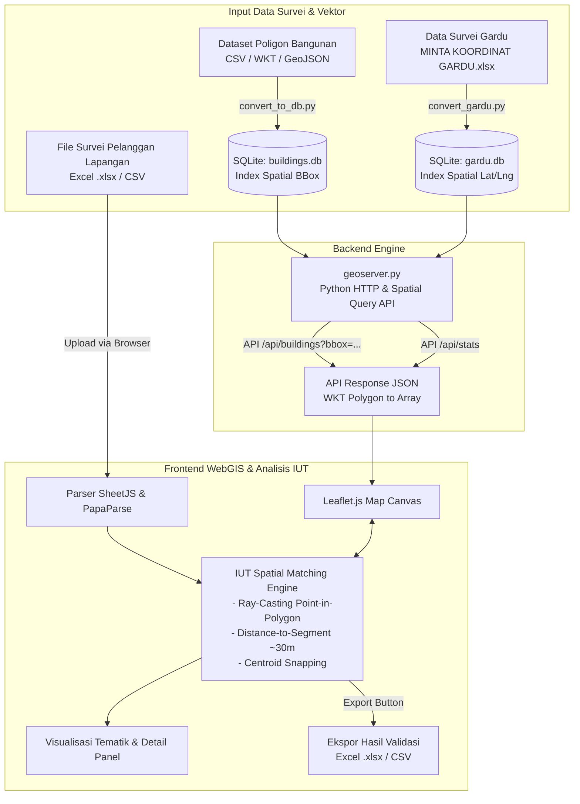

# 🌍 GeoSite PLN — Sistem Pemetaan Geospasial & Ilmu Ukur Tanah (IUT)

Platform WebGIS interaktif berbasis kaidah **Ilmu Ukur Tanah (IUT)** dan Geodesi untuk verifikasi koordinat survei lapangan, validasi tapak bangunan (*roof footprint*), dan pemetaan aset kelistrikan PLN (Gardu Distribusi & ID Pelanggan).

---

## 📌 Daftar Isi
- [Latar Belakang & Urgensi IUT](#-latar-belakang--urgensi-iut)
- [Prinsip Ilmu Ukur Tanah (IUT) yang Diterapkan](#-prinsip-ilmu-ukur-tanah-iut-yang-diterapkan)
- [Fitur Utama](#-fitur-utama)
- [Skema Kodifikasi Warna Tematik](#-skema-kodifikasi-warna-tematik)
- [Arsitektur Sistem](#-arsitektur-sistem)
- [Struktur Direktori](#-struktur-direktori)
- [Persyaratan Sistem](#-persyaratan-sistem)
- [Panduan Instalasi & Menjalankan](#-panduan-instalasi--menjalankan)
- [Panduan Pengolahan Data Survei Lapangan](#-panduan-pengolahan-data-survei-lapangan)
- [Konfigurasi Sistem](#-konfigurasi-sistem)
- [Format Output & Ekspor Data](#-format-output--ekspor-data)
- [Nilai Manfaat bagi Operasional PLN](#-nilai-manfaat-bagi-operasional-pln)

---

## 📖 Latar Belakang & Urgensi IUT

Dalam operasional PT PLN (Persero), pendataan koordinat geografis pelanggan dan gardu distribusi di lapangan sering kali mengandalkan survei lapangan (*ground survey*) menggunakan perangkat GPS handheld atau smartphone. Praktik pengukuran ini kerap menghadapi tantangan akurasi:

1. **Bias & Offset GPS**: Deviasi akurasi alat GPS di lapangan berkisar antara 5 hingga 30 meter akibat *Dilution of Precision* (DOP), pantulan sinyal (*multipath*), kanopi pohon, atau kerapatan gedung.
2. **Koordinat di Luar Tapak Fisik**: Koordinat survei sering tercatat di jalan, pekarangan, atau meleset ke bangunan tetangga, padahal instalasi kWh meter secara fisik menempel pada tapak bangunan pelanggan.
3. **Volume Data Masif**: Verifikasi jutaan titik pelanggan secara manual memerlukan waktu dan biaya tinggi.

**GeoSite PLN Berbasis IUT** memecahkan masalah ini dengan mengintegrasikan data vektor tapak bangunan riil (*building footprints*) dengan algoritma analisis spasial Ilmu Ukur Tanah secara otomatis, cepat, dan presisi.

---

## 📐 Prinsip Ilmu Ukur Tanah (IUT) yang Diterapkan

Sistem ini mengimplementasikan metode dan kaidah geodesi/IUT berikut:

### 1. Sistem Referensi Koordinat (Coordinate Reference System - CRS)
- Menggunakan datum geodesi global **WGS 84 (EPSG:4326)** dengan format Lintang (*Latitude/Y*) dan Bujur (*Longitude/X*) bersudut desimal (*decimal degrees*).

### 2. Pemodelan Geometri Vektor Bangunan (WKT Polygon)
- Tapak bangunan dimodelkan dalam format geometri standar **Well-Known Text (WKT)**:
  $$\text{POLYGON}((X_1\ Y_1, X_2\ Y_2, \dots, X_n\ Y_n, X_1\ Y_1))$$
- Menyimpan parameter fisik bangunan: Luas Area ($m^2$), Tingkat Kepercayaan Deteksi (*Confidence*), dan *Open Location Code* (Plus Code).

### 3. Uji Topologi Spasial: Algoritma Point-in-Polygon (Ray-Casting)
- Melakukan uji geometris apakah titik koordinat hasil survei ($X, Y$) berada tepat di dalam batas poligon tapak bangunan menggunakan metode *Ray-Casting*:
  - Garis imajiner ditarik dari titik uji ke arah tak terhingga.
  - Jumlah perpotongan dengan batas poligon ganjil $\rightarrow$ titik berada **di dalam tapak bangunan**.
  - Jumlah perpotongan genap $\rightarrow$ titik berada **di luar tapak bangunan**.

### 4. Toleransi Offset Pengukuran & Jarak Minimum (Point-to-Segment Distance)
- Untuk mengakomodasi deviasi alat ukur GPS lapangan, sistem menerapkan radius toleransi spasial:
  - Default toleransi: $\pm 30\text{ meter}$ ($\approx 0.0003^\circ$).
  - Sistem menghitung proyeksi jarak ortogonal terpendek antara titik ukur ke setiap segmen batas poligon:
    $$d_{\min} = \min_{j} \left( \|\mathbf{P} - \mathbf{P}_{\text{proj}, j}\| \right)$$
  - Jika titik berada dalam radius toleransi terhadap bangunan terdekat, titik tersebut dipasangkan dengan bangunan tersebut.

### 5. Normalisasi Posisi (Centroid Snapping)
- Titik survei yang tervalidasi cocok dengan tapak bangunan dapat secara otomatis di-*snap* ke titik berat (*centroid*) tapak bangunan untuk merapikan persebaran data spasial pada peta operasional.

---

## ✨ Fitur Utama

- 🚀 **High-Performance Spatial Viewport (Chunk Query)**
  - Mengambil data bangunan secara dinamis berdasarkan batas pandang (*Bounding Box* / BBOX: `minLng, minLat, maxLng, maxLat`).
  - Penyesuaian batas fitur adaptif sesuai tingkat zoom (1.000 hingga 5.000 poligon) untuk menjaga performa rendering Leaflet pada 60 FPS tanpa kehabisan memori (*memory leak*).
- 📑 **Dukungan Berbagai Format Survei Lapangan**
  - Menerima file survei dalam format **Excel (.xlsx)**, **CSV**, **GeoJSON**, dan **JSON**.
  - Fleksibel terhadap penamaan kolom koordinat: `LATITUDE`/`LONGITUDE`, `KOORDINAT_X`/`KOORDINAT_Y`, `LAT`/`LNG`.
- ⚡ **Integrasi Data Gardu Distribusi PLN**
  - Pengelolaan database gardu (`data/gardu.db`) yang memuat data teknis: No Gardu, Daya (kVA), Lokasi, dan Penyulang.
- 🗺️ **Pilihan Peta Dasar (Basemap)**
  - **OpenStreetMap**: Untuk navigasi jalan dan toponimi.
  - **Esri World Imagery (Citra Satelit Resolusi Tinggi)**: Untuk *ground checking* visual tapak bangunan secara fotogrametri/inderaja tanpa API key berbayar.
- 📊 **Panel Statistik & Inspeksi Geospasial**
  - Total bangunan dalam database, jumlah bangunan terlihat (*visible*), dan objek terpilih (*selected*).
  - Inspeksi detail koordinat, luas atap, Plus Code, status atap, dan atribut pelanggan/gardu.
- 💾 **Ekspor Data Hasil Validasi IUT**
  - Ekspor hasil validasi dan verifikasi kembali ke file Excel (`.xlsx`) atau CSV lengkap dengan klasifikasi status tapak bangunan.

---

## 🎨 Skema Kodifikasi Warna Tematik

Pewarnaan tematik pada peta dirancang untuk mempermudah surveyor dan evaluator IUT dalam membedakan status objek:

| Simbol / Warna | Status Objek | Penjelasan Teknis IUT |
| :--- | :--- | :--- |
| 🟪 **Ungu** (`#6366f1`) | **Bangunan Belum Teridentifikasi** | Tapak bangunan terdata pada sistem namun belum memiliki titik survei pelanggan yang cocok. |
| 🟦 **Biru** (`#3b82f6`) | **Bangunan Teridentifikasi** | Tapak bangunan yang memiliki satu atau lebih titik koordinat pelanggan valid di dalamnya. |
| 🟧 **Kuning / Oranye** (`#f59e0b`) | **Objek Terpilih (*Selected*)** | Poligon bangunan yang sedang dipilih oleh operator untuk inspeksi detail koordinat dan atribut. |
| 🟩 **Titik Hijau** (`#10b981`) | **Koordinat Valid (*In-Footprint*)** | Titik hasil survei berada tepat di dalam tapak bangunan atau dalam batas toleransi GPS. |
| 🟥 **Titik Merah** (`#ef4444`) | **Koordinat Perlu Verifikasi (*Anomaly*)** | Titik hasil survei berada di luar bangunan (anomali pengukuran lapangan / perlu survei ulang). |

---

## 🏗️ Arsitektur Sistem



---

## 📁 Struktur Direktori

```text
geosite-pln/
├── data/                             # Direktori data spasial (diabaikan dari Git)
│   ├── buildings.db                  # Database SQLite tapak bangunan (WKT & BBox)
│   ├── gardu.db                      # Database SQLite data gardu distribusi PLN
│   ├── 2e5_buildings.csv             # Sumber dataset mentah bangunan (opsional)
│   └── MINTA KOORDINAT GARDU.xlsx    # Data survei gardu PLN (opsional)
├── app.js                            # Logika utama WebGIS, algoritma IUT, & rendering
├── config.js                         # Konfigurasi koordinat peta, zoom, & styling
├── convert_gardu.py                  # Skrip ETL Excel gardu ke SQLite
├── convert_to_db.py                  # Skrip ETL CSV bangunan skala besar ke SQLite
├── geoserver.py                      # Server backend Python dengan API spatial query
├── index.html                        # Antarmuka antarmuka pengguna WebGIS
├── style.css                         # Tata letak & styling tema gelap responsif
├── package.json                      # Konfigurasi dependensi Node.js (SheetJS/xlsx)
└── README.md                         # Dokumentasi proyek
```

---

## 🛠️ Persyaratan Sistem

- **Python**: Versi 3.8 atau lebih baru.
- **Library Python**:
  - `pandas` (pemrosesan data tabular)
  - `openpyxl` (pembacaan format Excel)
- **Node.js** *(opsional, untuk modul xlsx lokal)*: v16+
- **Browser**: Google Chrome, Mozilla Firefox, Microsoft Edge, atau Safari versi terbaru.
- **Koneksi Internet**: Diperlukan untuk memuat *basemap tiles* (OpenStreetMap / Esri Satellite) dan pustaka CDN Leaflet.

---

## 🚀 Panduan Instalasi & Menjalankan

### 1. Clone Repository
```bash
git clone https://github.com/rizkipr05/geosite-pln.git
cd geosite-pln
```

### 2. Instal Dependensi Python
```bash
python -m pip install pandas openpyxl
```

### 3. Persiapan Database Spasial

#### A. Database Bangunan (`buildings.db`)
Jika Anda memiliki file CSV dataset bangunan (misalnya `data/2e5_buildings.csv`), jalankan:
```bash
python convert_to_db.py
```
> Skrip ini menggunakan mode *SQLite WAL* dan *batch insert* 50.000 baris untuk efisiensi penyimpanan jutaan poligon.

#### B. Database Gardu (`gardu.db`) *(Opsional)*
Jika memiliki data Excel gardu (`data/MINTA KOORDINAT GARDU.xlsx`), jalankan:
```bash
python convert_gardu.py
```

### 4. Jalankan GeoServer
Jalankan server aplikasi:
```bash
python geoserver.py
```
Server akan aktif pada port `8080`.

### 5. Buka Aplikasi di Browser
Akses alamat berikut pada browser:
```text
http://localhost:8080
```

---

## 📂 Panduan Pengolahan Data Survei Lapangan

1. **Siapkan File Survei**: Pastikan file Excel (`.xlsx`) atau CSV memiliki kolom koordinat:
   - Kolom Lintang: `LATITUDE`, `KOORDINAT_X`, atau `LAT`
   - Kolom Bujur: `LONGITUDE`, `KOORDINAT_Y`, atau `LNG`
   - Kolom Tambahan: `ID_PELANGGAN`, `NAMA`, `TARIF`, `DAYA`, dsb.
2. **Unggah File**: Buka antarmuka GeoSite PLN, seret (*drag & drop*) file ke area **Dataset** pada sidebar kiri atau klik tautan **pilih file**.
3. **Proses Pencocokan Spasial**:
   - Sistem secara otomatis memproses koordinat dengan algoritma *Point-in-Polygon* terhadap tapak bangunan pada *viewport* aktif.
   - Titik yang valid di atap/radius toleransi berubah menjadi **Hijau** dan tapak bangunan menjadi **Biru**.
   - Titik yang tidak menemukan bangunan dalam radius toleransi berubah menjadi **Merah**.
4. **Inspeksi Visual**:
   - Ganti *basemap* ke citra satelit (**Esri Satellite**) pada panel kontrol lapisan peta untuk memverifikasi kondisi atap bangunan secara visual.
   - Klik pada bangunan atau titik untuk melihat detail data teknis pada panel informasi.
5. **Unduh Hasil Verifikasi**:
   - Klik tombol **Export Data** untuk mengunduh laporan hasil klasifikasi dalam format `.xlsx`.

---

## ⚙️ Konfigurasi Sistem

Pengaturan awal peta dapat disesuaikan pada file [`config.js`](file:///home/rizky/Documents/geosite-pln/config.js):

```javascript
const CONFIG = {
  // Pusat peta awal (koordinat kepulauan Indonesia)
  DEFAULT_CENTER: { lat: -2.5489, lng: 118.0149 },
  DEFAULT_ZOOM: 5,

  // Gaya visual poligon bangunan standar (Belum Teridentifikasi)
  BUILDING_STYLE: {
    fillColor: "#6366f1",
    fillOpacity: 0.45,
    color: "#4f46e5",
    weight: 1.5,
  },

  // Gaya visual bangunan yang cocok dengan titik survei
  BUILDING_MATCHED_STYLE: {
    fillColor: "#3b82f6",
    fillOpacity: 0.65,
    color: "#2563eb",
    weight: 2,
  },

  // Gaya visual saat objek dipilih
  BUILDING_SELECTED_STYLE: {
    fillColor: "#f59e0b",
    fillOpacity: 0.7,
    color: "#d97706",
    weight: 3,
  },

  APP_TITLE: "GeoMap Bangunan — Analisis IUT",
};
```

---

## 📊 Format Output & Ekspor Data

File Excel/CSV hasil ekspor menyertakan atribut geospasial hasil validasi IUT:

| Kolom Ekspor | Keterangan |
| :--- | :--- |
| `Status_Bangunan` | `Dalam Kotak Bangunan` (valid) atau `Di Luar Bangunan` (anomali) |
| `Status_Atap` | `Ada Pelanggan` (terisi) atau `Tidak Ada Pelanggan` (kosong) |
| `latitude` / `longitude` | Koordinat titik ukur hasil survei lapangan |
| `Center_Lat` / `Center_Lng` | Koordinat titik pusat (*centroid*) poligon tapak bangunan |
| `Luas_Bangunan_m2` | Luas tapak bangunan fisik hasil kalkulasi geometris poligon |
| `Plus_Code` | Kode lokasi alfanumerik global (*Open Location Code*) |
| `ID_Pelanggan` / Atribut Asal | Seluruh kolom identitas pelanggan dari file input yang diunggah |

---

## 💡 Nilai Manfaat bagi Operasional PLN

1. **Pemutakhiran Master Data Spasial Pelanggan**: Menghilangkan koordinat "fiktif" atau melenceng di tengah jalan raya/hutan pada sistem informasi pelanggan.
2. **Efisiensi Validasi Lapangan**: Mengurangi kebutuhan verifikasi ulang secara fisik ke lapangan berkat validasi otomatis terhadap citra tapak bangunan.
3. **Optimalisasi Penataan Jaringan Distribusi**: Memastikan pemetaan sambungan rumah (SR) ke tiang dan gardu distribusi berbasis posisi tapak fisik bangunan yang sebenarnya.
4. **Analisis Kerapatan Beban (*Spatial Load Density*)**: Memanfaatkan data luas atap ($m^2$) dan jumlah pelanggan per poligon untuk memproyeksikan kebutuhan kapasitas trafo gardu.

---

<div align="center">
  <b>GeoSite PLN — Presisi Pengukuran Tanah, Akurasi Data Spasial, Efisiensi Energi.</b><br/>
  <i>Dikembangkan untuk standardisasi validasi data spasial ketenagalistrikan berbasis Ilmu Ukur Tanah (IUT).</i>
</div>
